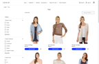
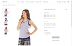
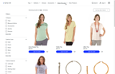

# PWA Studio Release 14.5.2

**NOTE:**
_This changelog only contains release notes for PWA Studio and Venia 14.5.2_
_For older release notes, see_ [PWA Studio releases][].

## Highlights

The 14.5.2 release of PWA Studio provides support to PHP 8.5 and  multiple bug fixes.

## Additional fixes
-  Bug:[4620][] — Updated UpwardConnector to support New Relic nonce
-  Bug:[32][] — Self Originating Laminas_Http_Client GraphQL requests in PWA architecture has been reolved
-  Bug:[33][] — Magento UPWARD Connector Prerender TypeError and Syntax Error has been resolved
-  Bug:[4623][] — MagentoGQLCacheLink sends x-magento-cache-id: null on GraphQL requests before a cache id is established, causing a large number of PASS requests has been resolved
-  Bug:[32][] — Class type (PHP 8.5) error during sample data installation has been resolved
-  Bug:[4626][] - 301/302 custom URL redirects show "page not found" instead of redirecting has been resolved

## 14.5.2 Lighthouse scores

With each new release of PWA Studio, we perform Lighthouse audits on four Venia page types, each representing a different level of complexity.
Shown below are the Lighthouse scores for the 14.5.2 release of these pages on desktop and mobile devices.
### Desktop scores

|                |            Home Page            |          Product Category           |          Product Details           |          Search Results           |
|---------------:|:-------------------------------:|:-----------------------------------:|:----------------------------------:|:---------------------------------:|
|    **Desktop** |  |  |  |  |
|    Performance |         |             |            |           |
|  Accessibility |        |            |           |          |
| Best Practices |        |            |           |          |
|            SEO |        |            |           |          |
|            PWA |      |          |         |         |

### Mobile scores

|                | &nbsp;&nbsp;Home Page&nbsp;&nbsp; |          Product Category           |          Product Details           |          Search Results           |
|---------------:|:---------------------------------:|:-----------------------------------:|:----------------------------------:|:---------------------------------:|
|     **Mobile** |    |  |  |  |
|    Performance |           |             |            |           |
|  Accessibility |          |            |           |          |
| Best Practices |          |            |           |          |
|            SEO |          |            |           |          |
|            PWA |        |        |       |        |

## Known issue

When a user logs out, that user's local storage session persists. As a result, the cart ID from the logged-out user is retrieved and assigned to the guest user on the same computer.
This causes the following error when the guest user tries to check out:
An error has occurred. Please check the input and try again. 

To resolve this issue, try disabling graphql session sharing as described in the GraphQL documentation on session cookies here: https://devdocs.magento.com/guides/v2.4/graphql/authorization-tokens.html#session-cookies.

## Upgrading from a previous version

Use the steps outlined in this section to update your [scaffolded project][] from 14.5.1 to 14.5.2
See [Upgrading versions][] for more information about upgrading between PWA Studio versions.

[scaffolded project]: https://developer.adobe.com/commerce/pwa-studio/tutorials/
[upgrading versions]: https://developer.adobe.com/commerce/pwa-studio/guides/upgrading-versions/

### Updated package dependencies

Open your `package.json` file and update the PWA Studio package dependencies to the versions associated with this release.
The following table lists the latest versions of each package as of 14.5.2. The **bolded** versions with an asterisk (*) are the packages that were updated from PWA Studio 14.5.0.

**NOTE:**
Your project may not depend on some packages listed in this table.

| Package                                | Latest version |
|----------------------------------------|----------------|
| `babel-preset-peregrine`               | 1.3.3          |
| `create-pwa`                           | **2.5.11***     |
| `experience-platform-connector`        | **1.0.14***    |
| `upward-security-headers`              | **1.1.22***    |
| `venia-sample-backends`                | 0.0.13         |
| `venia-sample-eventing`                | **0.0.15***    |
| `venia-sample-language-packs`          | **0.0.23***    |
| `venia-sample-payments-checkmo`        | **0.0.21***    |
| `venia-sample-payments-cashondelivery` | **0.0.6***     |
| `venia-pwa-live-search`                | **1.0.4***     |
| `venia-product-recommendations`        | 1.0.2          |
| `plugin-braintree-three-d-secure`      | 1.0.1          |
| `pagebuilder`                          | **9.3.9***     |
| `peregrine`                            | **15.7.4***    |
| `pwa-buildpack`                        | 11.5.5         |
| `pwa-theme-venia`                      | 2.4.0          |
| `upward-js`                            | 5.4.3          |
| `upward-spec`                          | 5.3.1          |
| `venia-concept`                        | **14.5.2***    |
| `venia-ui`                             | **11.7.4***    |
| `magento2-pwa`                         | **0.10.5***    |
| `magento2-pwa-commerce`                | 0.1.6          |
| `magento-venia-sample-data-modules`    | **0.0.8***     |
| `magento-venia-sample-data-modules-ee` | **0.0.8***     |
| `magento2-upward-connector`            | **2.1.8***     |
| `upward-php`                           | 2.1.5          |
| `pwa-live-search`                      | **1.0.2***     |

[4620]: https://github.com/magento/pwa-studio/pull/4620
[32]: https://github.com/magento-commerce/magento2-upward-connector/pull/32
[33]: https://github.com/magento-commerce/magento2-upward-connector/pull/33
[4623]: https://github.com/magento/pwa-studio/pull/4623
[32]: https://github.com/magento-commerce/venia-sample-data-modules/pull/32
[4626]: https://github.com/magento/pwa-studio/pull/4626

[PWA Studio releases]: https://github.com/magento/pwa-studio/releases
